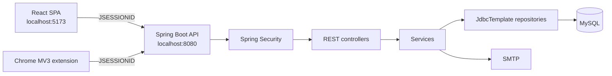

# Snippet Vault

A self-hosted code snippet manager with private, group, and public vaults, append-only version history, version-pinned forking, and a Chrome extension for capturing code from any page.

[](LICENSE)


> **Screenshot pending.** Capture `docs/assets/dashboard.png` using the instructions in [docs/assets/README.md](docs/assets/README.md), then add it here.

## Features

- **Three visibility levels** — keep snippets private, share them with a group, or publish them to the public feed.
- **Version history** — every edit creates a new immutable revision; restore any earlier revision in one action.
- **Version-pinned forks** — copy a specific revision of someone else's snippet into your own private vault.
- **Groups and folders** — join groups with a short code, organize snippets into folders, and scope access by membership.
- **Browser capture** — save selected code from any page through a Chrome (Manifest V3) extension.
- **Session-based auth** — registration, login, logout, and email-based password reset.

## Quickstart

**Prerequisites:** Java 21+, Node.js 20+, MySQL 8+.

```bash
git clone https://github.com/DIVESHvalecha/SnippetVault.git
cd SnippetVault
```

1. Create the database and tables. `docs/schema.sql` is reconstructed from the repository layer; `SnippetVault/queries.sql` is a historical scratchpad and is **not** executable as-is.

   ```bash
   mysql -u root -p -e "CREATE DATABASE IF NOT EXISTS SnippetVault CHARACTER SET utf8mb4;"
   mysql -u root -p SnippetVault < docs/schema.sql
   ```

2. Point the backend at your database. These environment variables override `SnippetVault/src/main/resources/application.properties`:

   ```bash
   export SPRING_DATASOURCE_URL='jdbc:mysql://localhost:3306/SnippetVault'
   export SPRING_DATASOURCE_USERNAME='root'
   export SPRING_DATASOURCE_PASSWORD='your-mysql-password'
   cd SnippetVault
   ./gradlew bootRun
   ```

   The API starts on `http://localhost:8080`.

3. In a second terminal, start the web app:

   ```bash
   cd SnippetValut-Frontend
   npm ci
   npm run dev
   ```

   Open `http://localhost:5173`, create an account, and log in. The Vite dev server and the API are separate origins; the backend CORS allowlist already includes `http://localhost:5173`.

4. Optional — load the extension:

   - Open `chrome://extensions`, enable **Developer mode**, choose **Load unpacked**, and select `SnippetValut-Extension/`.
   - Log in to the web app in the same browser first (the extension reuses the session cookie).
   - Select text on any page, right-click, and choose **Save to Snippet Vault**.

   The extension only targets `http://localhost:8080`. If Chrome assigns a different extension ID than the one in `SecurityConfig`, add your `chrome-extension://<id>` origin to the CORS allowlist.

> The database and mail steps were not executed during the documentation pass because MySQL root credentials were unavailable. They are marked `[UNVERIFIED]` in the setup docs.

## Usage

All examples assume the API is on `http://localhost:8080` and that you keep the session cookie in `cookies.txt`.

**Register and log in**

```bash
curl -s -X POST http://localhost:8080/register \
  -H 'Content-Type: application/json' \
  -d '{"name":"Dev User","username":"devuser","email":"dev@example.com","password":"ChangeMe123!","phoneNo":"9876543210"}'

curl -s -c cookies.txt -X POST http://localhost:8080/login \
  -H 'Content-Type: application/x-www-form-urlencoded' \
  -d 'email=dev@example.com&password=ChangeMe123!'
```

**Create a private snippet**

```bash
curl -s -b cookies.txt -X POST http://localhost:8080/create-snippet \
  -H 'Content-Type: application/json' \
  -d '{"title":"Read a file","description":"Reads a UTF-8 file with java.nio","language":"java","visibility":"PRIVATE","content":"Files.readString(Path.of(\"notes.txt\"));"}'
```

**List your snippets**

```bash
curl -s -b cookies.txt http://localhost:8080/snippets/own
```

**Fork a specific revision**

```bash
# 1. See the available revisions
curl -s -b cookies.txt http://localhost:8080/snippets/42/versions

# 2. Fork revision 2 into your own private vault
curl -s -b cookies.txt -X POST http://localhost:8080/snippets/42/fork/2
```

More examples and the full endpoint list are in [docs/api.md](docs/api.md).

## Architecture

The React SPA and the Chrome extension are separate clients of one Spring Boot API. Spring Security authenticates both with an HTTP session cookie. The API uses `JdbcTemplate` against MySQL; a snippet edit appends to `snippet_versions` and bumps `snippets.current_version`, while a fork copies a chosen revision into a new private snippet.



See [docs/architecture.md](docs/architecture.md) for the data flow, schema, and access rules.

## Configuration

| Variable | Purpose | Default | Required |
| --- | --- | --- | --- |
| `SPRING_DATASOURCE_URL` | JDBC URL for MySQL | Value in `application.properties` | Yes |
| `SPRING_DATASOURCE_USERNAME` | Database user | Value in `application.properties` | Yes |
| `SPRING_DATASOURCE_PASSWORD` | Database password | Value in `application.properties` | Yes |
| `SPRING_MAIL_HOST` | SMTP host for password-reset mail | Value in `application.properties` | For password reset |
| `SPRING_MAIL_PORT` | SMTP port | Value in `application.properties` | For password reset |
| `SPRING_MAIL_USERNAME` | SMTP user | Value in `application.properties` | For password reset |
| `SPRING_MAIL_PASSWORD` | SMTP password | Value in `application.properties` | For password reset |
| `SPRING_MAIL_PROPERTIES_MAIL_SMTP_AUTH` | Enable SMTP auth | Value in `application.properties` | For password reset |
| `SPRING_MAIL_PROPERTIES_MAIL_SMTP_STARTTLS_ENABLE` | Enable STARTTLS | Value in `application.properties` | For password reset |
| `SERVER_PORT` | API port | `8080` | No |

The frontend and extension currently hardcode `http://localhost:8080`. There are no frontend environment variables. Full details: [docs/configuration.md](docs/configuration.md).

> **Security note:** `application.properties` is tracked and currently contains literal datasource and mail credentials. Rotate those credentials and move them to environment variables before publishing the repository.

## Roadmap and known limitations

- **No AI/vector search.** Semantic search and snippet explanation are not implemented; the UI search is an in-memory substring filter over title, description, and language.
- **The extension's keyboard shortcut is incomplete.** The context-menu capture path works; `Ctrl/Cmd+Shift+S` sends a message the background worker does not handle.
- **The extension cannot reliably attach a captured snippet to a folder**, because the create endpoint does not return the new snippet ID.
- **`SnippetVault/queries.sql` is stale.** `docs/schema.sql` is the reconstructed schema and is marked `[UNVERIFIED]`.
- **Low test coverage.** The backend has a single context-load test; the frontend has no tests.
- **Lint is red.** `npm run lint` reports 29 errors and 2 warnings. `npm run build` passes.
- **No CI, no releases, no tags.**
- **CSRF is disabled** and there is no rate limiting or request validation.

## Contributing

See [CONTRIBUTING.md](CONTRIBUTING.md). For security issues, follow [SECURITY.md](SECURITY.md) instead of opening a public issue.

## License

[MIT](LICENSE) © 2025-2026 Divesh Valecha.
