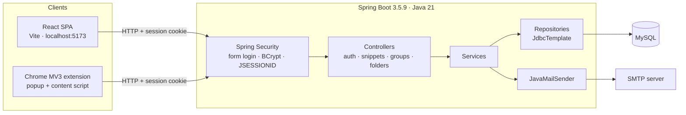
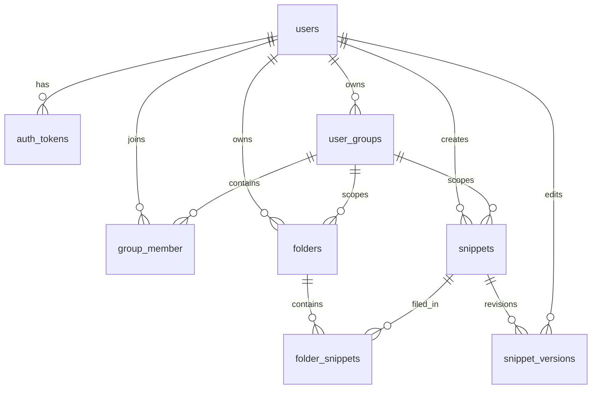

# Architecture

Snippet Vault is a two-client system: a React single-page app and a Chrome extension, both calling one Spring Boot REST API backed by MySQL.

## Components

| Layer | Location | Responsibility |
| --- | --- | --- |
| SPA | `SnippetValut-Frontend/` | Login/signup/reset, dashboard, snippet editor (Monaco), version history panel, groups, folders. |
| Extension | `SnippetValut-Extension/` | Manifest V3 popup, context-menu capture, language detection, session reuse. |
| Security | `SnippetVault/src/main/java/com/divesh/SnippetVault/SecurityConfig.java` | Form login at `/login`, BCrypt encoder, session cookie, CORS, logout. |
| Controllers | `.../controller/` | 27 REST endpoints across auth, snippets, groups, folders. |
| Services | `.../service/` | Ownership/group checks, transaction boundaries, current-user lookup. |
| Repositories | `.../repository/` | Hand-written SQL via `JdbcTemplate`; row mapping. |
| Schema | `docs/schema.sql` (reconstructed), `SnippetVault/queries.sql` (historical) | Eight tables. |

## Data flow: creating a snippet

1. The React `SnippetContext` normalizes the form: `code` becomes `content`, and visibility is upper-cased (`private` → `PRIVATE`) before calling `POST /create-snippet`.
2. Spring Security resolves the `JSESSIONID` cookie to a `CustomUserDetails` principal.
3. `SnippetService.createSnippet` takes the user ID from the security context. If `groupId` is set, it checks `group_member` and rejects the request when the caller has not joined.
4. `SnippetRepository.createSnippet` inserts the `snippets` row and, in the same transaction, inserts version 1 into `snippet_versions`.
5. If `folderId` is present, `FolderService.addSnippetToFolder` links the snippet, but only when the folder belongs to the caller.
6. The endpoint returns `{"body":"Snippet created successfully"}`. It does **not** return the new snippet ID.

## Data flow: editing and restoring

- **Edit:** `PATCH /snippets/{id}` reads `current_version`, inserts a new `snippet_versions` row at `current_version + 1`, then updates the `snippets` row and bumps `current_version`. The write is transactional.
- **Restore:** `POST /snippets/{id}/restore/{versionNumber}` reads the old revision (owner only), then calls the same edit path. Restoring therefore appends a **new** version containing the old content; it is not a destructive rollback.
- **History:** `GET /snippets/{id}/versions` returns all revisions newest-first, with access granted to the owner, anyone if the snippet is `PUBLIC`, or a member of the snippet's group.

## Data flow: forking

`POST /snippets/{id}/fork/{versionNumber}`:

1. `SnippetRepository.fork` selects the immutable title, description, content, and language of the requested revision. The SQL only returns a row if the caller owns the snippet, the snippet is `PUBLIC`, or the caller belongs to the snippet's group.
2. The result is rewritten as `visibility = PRIVATE`, `groupId = null`, `folderId = null`.
3. `SnippetService.createSnippet` inserts a new snippet owned by the caller and initializes it at version 1.

This preserves the exact selected revision, but the schema stores **no parent link or attribution**. Fork lineage is not queryable.

## Access model

| Operation | Rule |
| --- | --- |
| `GET /snippets/public` | Any authenticated user. |
| `GET /snippets/own`, `/snippets/private` | Caller's own rows. |
| `GET /snippets/group/{groupCode}` | Caller must be an active member of the group. |
| `GET /snippets/{id}` | **Owner only** — a public snippet cannot be fetched through this endpoint by another user. |
| `GET /snippets/{id}/versions` | Owner, `PUBLIC` snippet, or active group member. |
| `GET /snippets/{id}/versions/{n}` | Owner only. |
| `POST /snippets/{id}/restore/{n}` | Owner only. |
| `POST /snippets/{id}/fork/{n}` | Owner, `PUBLIC` snippet, or active group member. |
| Folder endpoints | Folder owner only. |
| Group create/join/leave | Authenticated user; membership is tracked in `group_member`. |

Authorization is embedded in SQL predicates rather than a centralized policy layer. The same "owner OR public OR joined group" rule appears in the version-history query and the fork query, so changes must be kept in sync manually.

## Schema

| Table | Purpose |
| --- | --- |
| `users` | Account, BCrypt password hash, active flag. |
| `auth_tokens` | Single-use password-reset tokens with a 15-minute expiry. |
| `user_groups` | Group metadata, random 6-character join code, `PUBLIC`/`PRIVATE` group visibility. |
| `group_member` | Membership plus soft-delete `active_yn`. |
| `snippets` | Current head of a snippet, visibility, soft delete, `current_version`. |
| `snippet_versions` | Append-only revisions with editor and timestamp. |
| `folders` | User-owned folders, optionally group-scoped. |
| `folder_snippets` | Many-to-many link with soft delete. |

## Non-obvious decisions

- **`JdbcTemplate` instead of JPA.** SQL is explicit and reviewable; there is no ORM cache or lazy-loading layer. The cost is manual mapping and repeated predicates.
- **Form login instead of JWT.** One session cookie serves both the SPA and the extension with no token storage. The cost is CSRF being disabled and CORS being origin-list-based.
- **Append-only versions.** History and forks never mutate old revisions. There is no retention or compaction policy, so versions grow forever.
- **Snippet head plus version rows.** `snippets` stores the current content for fast reads; `snippet_versions` stores history. A transaction keeps them consistent on edit.
- **Soft deletes.** Snippets and folders set `active_yn = 0`; rows remain in the database.
- **Extension reuses the web session.** The popup calls `/snippets/own` to test authentication and relies on the browser sending the cookie.

## Failure modes

- Database unavailable: requests return `500`; there is no retry, circuit breaker, or timeout configuration.
- Missing snippet or version: `EmptyResultDataAccessException` surfaces as `500`, not `404`.
- SMTP failure during forgot-password: `EmailService` throws `RuntimeException`; the endpoint returns `500`.
- Invalid or expired reset token: `400 {"body":"Invalid token"}`.
- Unauthenticated request: `401 {"error":"Please Login"}`.
- `NULL` `group_id`: `SnippetRowMapper` uses `ResultSet.getLong`, so the JSON contains `0` rather than `null`.
- No rate limiting, request validation, or structured audit logging.
